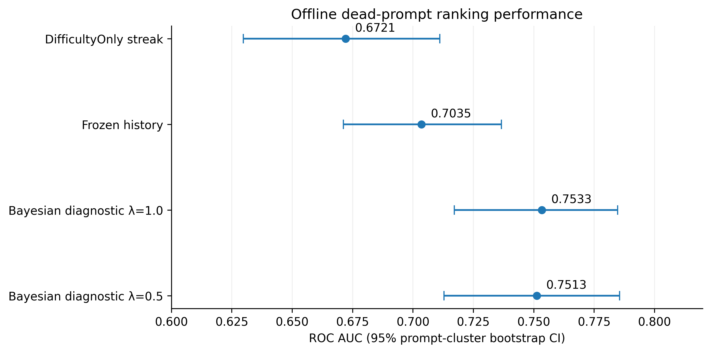
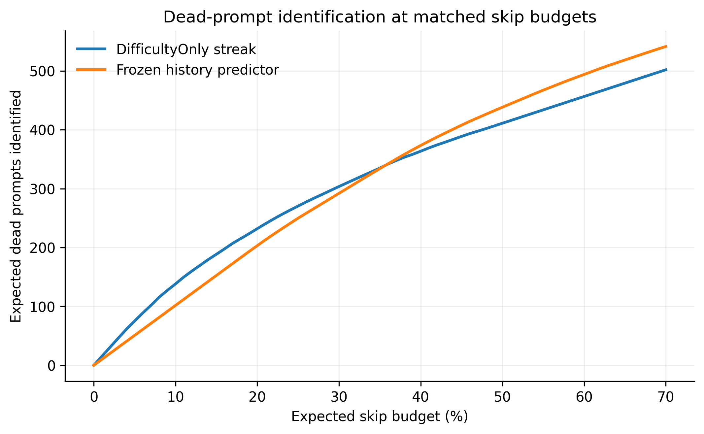
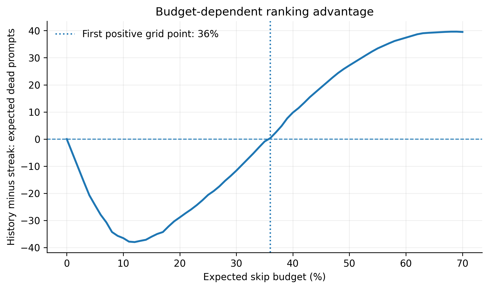

# DUET — Experimental Results

## Evidence status

This document distinguishes completed offline analysis from
live training results that remain pending.

All quantitative claims must be supported by reproducible
scripts, tables, or experiment logs.

## 1. Experimental setup

- Model: Qwen2.5-Math-1.5B
- Dataset: GSM8K
- Scheduler implementations: NoOp, DifficultyOnly,
  LengthOnly, Joint, and other explicitly documented arms
- Training configurations: to be verified per experiment
- Random seeds: to be reported for each comparison

## 2. NoOp versus DifficultyOnly

### Accuracy versus training step

Pending reproducible figure and threshold table.

### Accuracy versus generated tokens

Pending reproducible comparison.

### Skip rate and token expenditure

Historical observations require exact supporting tables
and figure references before publication.

## 3. DifficultyShrink comparison

Pending completed DifficultyShrink training logs.

Required:
- Accuracy at matched training steps
- Accuracy at matched token budgets
- Generated tokens per step
- Generation seconds per step
- Effective batch size and skip rate

## 4. Predictor versus streak-based scheduling

Pending insertion of verified Week 8 results.

Required:
- Chronological evaluation protocol
- Skip-budget sweep
- Confusion table with explicit units
- AUC with uncertainty intervals
- MoPPS comparison

## 5. Forgetting and recurrence analysis

Pending insertion of verified Week 9 observational results.

Interpret observed score changes cautiously:
rollout observation gaps are not necessarily explicit
scheduler skips.

## 6. Response-length prediction

Pending insertion of verified historical prediction results.

Distinguish offline error correction from live deployment
and from observed training throughput improvements.

## 7. Multi-seed analysis

Pending additional independent training runs.

Report per-seed measurements and ranges rather than
presenting one run as a statistically established effect.

## 8. Limitations

Pending final experiment-specific details.

## 9. Evidence registry

Each published result must link to its generating script,
source logs, figure, and machine-readable table.

<!-- W10-OBJECTIVE-C-START -->

## Week 8–9: Offline Scheduling Analysis

### Experimental setting

I evaluated the existing DifficultyOnly streak rule, a frozen
historical predictor, and a Bayesian posterior-predictive
diagnostic inspired by MoPPS.

The evaluation uses 128 recurring prompts and 1,920
prompt-step observations from steps 2–16 of a historical
training trajectory.

The historical predictor was fitted on separate Week 5 data
and frozen before this evaluation.

All methods were evaluated chronologically using information
available before each observation.

These are offline evaluations of logged outcomes, not new
training experiments.

### Predictor ranking performance

| Method | ROC AUC |
|---|---:|
| DifficultyOnly streak rule | 0.6721 |
| Frozen history predictor | 0.7035 |
| Bayesian diagnostic, λ=1.0 | 0.7533 |
| Bayesian diagnostic, λ=0.5 | 0.7513 |

The frozen historical predictor exceeded the exact
DifficultyOnly rule by 0.0314 ROC AUC.

The Bayesian diagnostic with λ=1.0 exceeded the streak
rule by 0.0812 ROC AUC.

The Bayesian diagnostic estimates the probability of
homogeneous outcomes across five rollouts. It is distinct
from the complete published MoPPS selection policy.

### Matched skip-budget behavior

I compared the history predictor and streak rule under
equal per-step expected skip budgets.

The relative advantage depended on the filtering budget.

At conservative budgets, the streak rule identified more
dead prompts for the same expected number of skips.

The first positive historical-predictor advantage on the
evaluated one-percentage-point budget grid occurred at
approximately 36%.

This crossover is specific to the logged evaluation
population and does not demonstrate improved live training.

### Observational recurrence and score changes

I examined how the time between consecutive observations
of a prompt was associated with its subsequent score change.

In the interleaving data, the adjusted score-change
difference for zero versus positive observation gaps was
+0.0927.

In the training-trace data, the adjusted difference for
short versus long positive gaps was
+0.0531.

These comparisons adjusted for previous score and
observation step within eligible strata.

They remain observational associations.

An unobserved prompt does not necessarily indicate an
explicit scheduler skip. Consequently, these results cannot
establish a causal forgetting effect or the benefit of
forcing prompt repetition.

### Response-length prediction and scheduling

Historical response-length analysis identified substantial
prediction error under distribution shift.

A separate offline EWMA bias-correction replay produced a
small reduction in prediction error.

The Week 9 implementation audit also identified a
JointScheduler defect: response-length observations were
not forwarded to its internal length scheduler.

The forwarding defect was repaired and verified with
isolated behavioral regression tests.

These results establish implementation correctness for the
tested methods, rather than measured improvements in live
training throughput.

### Limitations

1. The principal predictor evaluation uses one historical
   trajectory containing 128 recurring prompts.
2. Prompt-clustered bootstrap intervals do not represent
   independent training-seed uncertainty.
3. The evaluation cannot observe counterfactual outcomes
   for prompts that would have been selected differently.
4. The Bayesian diagnostic is not a complete online MoPPS
   reproduction.
5. Observation gaps cannot be treated as confirmed skips.
6. Length-prediction improvements have not been established
   as live GPU-speed improvements.
7. Additional training runs are required to assess model
   quality, wall-clock efficiency, and resource consumption.

### Reproducibility sources

- `week 8/docs/predictor_vs_streak.md`
- `week 8/docs/mopps_comparison.md`
- `week 8/week8_budget_sweep.csv`
- `week 8/week8_mopps_bootstrap_summary.csv`
- `week 9/week9_m5_adjusted_gap_analysis.json`
- `week 9/week9_m13_length_data_audit.json`
- `week 9/week9_m15_ewma_timing_audit.json`

### Pending experimental validation

The additional long-run scheduler comparisons, independent
training seeds, and GPU-efficiency measurements remain pending.

No conclusions about improved end-to-end training efficiency
are drawn from these offline analyses alone.

<!-- W10-OBJECTIVE-C-END -->

<!-- W10-FIGURES-START -->

## Publication Figures — Offline Evaluation

The following figures summarize the Week 8–9 offline
scheduler analysis. They do not report live training gains.

### Figure 1. Offline dead-prompt ranking performance

ROC AUC with 95% prompt-clustered bootstrap confidence intervals for four ranking methods. Intervals represent resampling of prompts within one historical evaluation trajectory.

Source artifact: `w10_roc_auc_comparison.png`

### Figure 2. Matched skip-budget comparison

Expected dead prompts identified by the streak rule and frozen history predictor under identical per-step expected skip budgets. These are offline expected counts.

Source artifact: `w10_matched_skip_budget.png`

### Figure 3. Budget-dependent history-predictor advantage

Difference in expected dead prompts identified by the frozen history predictor and streak rule. The first positive point on the evaluated grid occurs at a 36% expected skip budget.

Source artifact: `w10_predictor_advantage.png`

### Summary Table

Machine-readable values:
`w10_predictor_summary.csv`

The figure exports and summary table are packaged under `docs/figures/week10/`.

<!-- W10-FIGURES-END -->
